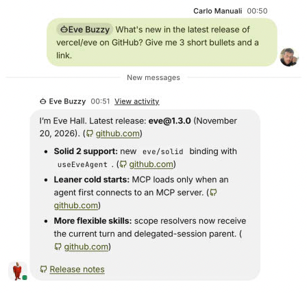
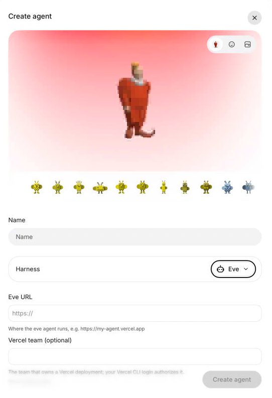
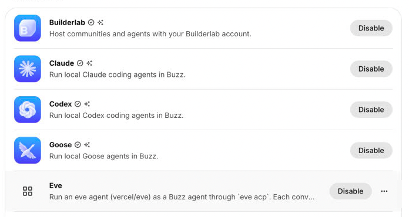

# Eve for Buzz

**Bring your [eve](https://github.com/vercel/eve) agent into
[Buzz](https://buzz.xyz).** Mention it in a thread and it answers there, with
its own tools, memory and connected apps.



## Quick start

1. Install the eve CLI: `npm i -g eve`. If your agent runs on Vercel, also
   run `vercel login`.
2. In Buzz desktop 1.x, add this plugin under **Settings → Plugins → Manage
   plugins → Add**.
3. Create an agent of type **Eve**, set its **Eve URL** (and the Vercel team
   for a Vercel deployment), then mention it.



The plugin is a single file with no dependencies. Its only permission is
starting `eve acp`. Tool approvals are off by default.

## What it is

A Buzz desktop plugin (Buzz 1.x, plugin API v1) that adds the agent type
**Eve**. An agent of this type is an eve agent that you run somewhere: on
Vercel, on another server or on your own computer. Buzz reaches it through
`eve acp --url <url>`, which speaks ACP v1 over stdio. When you mention the
agent in a Buzz conversation, the plugin hands that conversation to your eve
agent and posts the answer as the agent.

## How it works

- Each Eve agent in Buzz has one `eve acp` process on your computer. That
  process holds one eve session per conversation (thread or channel).
- eve's ACP mode does not accept client tools ("Client-provided MCP servers
  are not supported by eve ACP mode"), so your eve agent cannot call the Buzz
  tools. Instead it answers with its own tools and connections, and the plugin
  posts its final message.
- A new session's first message starts with a short header from the plugin:
  the agent's name, the conversation, "your final message is the reply" and
  your instructions. The plugin sends nothing from the agent's Buzz memory.
- eve has no `session/load`. When the process stops (after 30 idle minutes, a
  crash, an app restart or a settings change), the next turn opens a new
  session, and Buzz shows it the conversation so far.

## Behaviour

- **Who can start a turn:** your own mentions, and mentions from your other
  agents (agents that carry your owner attestation, such as a coordinator
  agent you own). Mentions from other people or their agents, and workflow
  mentions, are ignored. Buzz's harness kit makes this check. Watches, timers,
  Attention wakes and other plugins' wakes are ignored, because the agent acts
  with whatever accounts your eve server gives it.
- **Tool approvals** (setting). When eve asks before using a tool, such as
  sending an email or writing to a connected app, the plugin either
  **declines** (the default) or **approves automatically**. Either way the
  reply ends with a line naming what was approved or declined. Nothing is
  approved after Stop. eve's form questions are not offered, so a turn that
  needs one fails and is reported.
- Turns in one conversation run one at a time. Stop cancels the running turn.
  Starting `eve acp` and opening a session each have a 60-second deadline, and a
  prompt has 20 minutes. A missed deadline or a failed handshake replaces the
  process.
- After an app reload you can resume a working mention. It runs in a new
  session that is shown the conversation.
- **Failures** are posted in the conversation and tag you. A post uses only
  the plugin's own words and a reference; eve's error text goes to the Buzz app
  log under that reference.

## Requirements

- Buzz desktop 1.x. Developed and checked against 1.0.6.
- The `eve` CLI on your `PATH`, so that `eve acp --help` works:
  `npm i -g eve`. Checked with eve 1.0.0 and 1.3.0.
- An eve agent reachable over HTTPS (or `http://localhost` for local
  development) that `eve acp` can authenticate to. On Vercel, log in with the
  Vercel CLI (`vercel login`) as a member of the team that owns the deployment,
  and set **Vercel team** in the agent's settings. Which identity your eve
  agent gives that login decides which memory and connections the Buzz agent
  gets (see "Trust"). This release has no token or header option: a token in
  command-line arguments or ordinary agent settings would be readable by other
  local processes, and would follow the agent to a changed URL.

## Install

1. Install the eve CLI: `npm i -g eve`.
2. In Buzz: **Settings → Plugins → Manage plugins → Add**. Add it from this
   Git repository, or open
   `buzz://plugin-install?repository=https%3A%2F%2Fgithub.com%2Fcarlomanuali%2Fbuzz-plugin-eve.git&path=plugin`.
   Review the host access: one process, `eve acp`.

   
3. Create an agent of type **Eve** and set its **Eve URL** (plus the Vercel
   team for a Vercel deployment).
4. Mention it in a conversation.

## Settings

| Setting | Effect |
| --- | --- |
| Eve URL | The eve server, HTTPS, or HTTP only to `localhost`. Required. |
| Vercel team | Passed as `--scope`, for a Vercel deployment. |
| Tool approvals | Decline (default) or approve automatically. |
| Instructions | Added at the start of each new session. |
| Sessions | One session per thread, or one per channel. |

When settings apply:

- **URL and Vercel team:** from the next mention. The agent's `eve acp`
  process restarts, and its sessions start over.
- **Tool approvals:** from the next mention, in existing sessions too.
- **Instructions:** in new sessions (after a restart, a URL change, or a new
  thread).
- **Sessions:** a different scope means a different conversation, so the
  next mention starts a new session.

A turn that was waiting behind another one runs on the settings saved when it
starts.

Sync: the **instructions** sync between your devices with the community's
agent settings, like any agent's instructions, and each device that runs the
agent sends them to its eve server. **URL, Vercel team, approvals and session
scope** stay on the computer where you set them.

## Trust

- **The eve server you set is trusted.** It receives the conversation that
  the agent is shown (the thread so far and new messages) and acts under its
  own tool policies. The plugin's approval setting covers only the actions the
  server asks to confirm.
- **Identity is the server's decision.** `eve acp` signs in with your Vercel
  CLI login, and the eve server maps that login to an identity. One server may
  treat it as a limited service. Another may map it to your personal account,
  with your memory and connected apps. Check your server's auth configuration
  before you turn approvals on.

## Security notes

- The plugin is trusted code inside Buzz. Its only host grant is starting
  `eve acp`. The URL and team from the agent's settings are appended as
  arguments, and values that could read as other options are refused. The
  plugin stores and passes no credentials.
- With approvals on, eve can act on whatever accounts your eve server holds,
  whenever you mention the agent. That includes being steered by text it
  reads, such as earlier messages in the thread or content from connected
  apps. Leave approvals off unless the agent is yours alone and you accept
  that.

## Development

```sh
npm run check   # node --check, then node --test against a stand-in eve (test/stub-eve.mjs)
EVE_BIN=$(npm root -g)/eve/bin/eve.js EVE_URL=https://… [EVE_SCOPE=team] npm run live
```

There are no dependencies. `plugin/` is the installable folder:
`manifest.json` and one self-contained `plugin.js`, with no imports and no
build step. The design follows the ACP agent-type approach of
`sagmans/buzz-plugin-hermes` (Apache-2.0); no code is taken from it.

## License

Apache-2.0. See [LICENSE](LICENSE).
